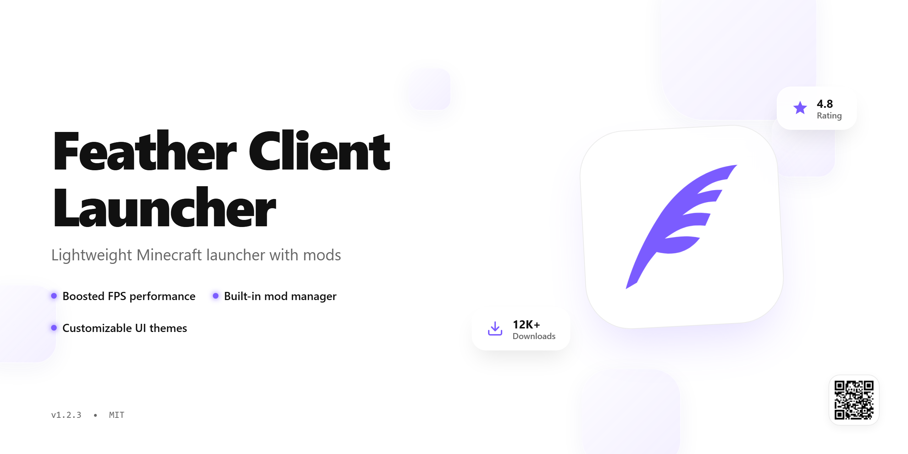

# Feather Client Launcher: Minecraft Java Launcher with Mods, Voice & HUD for Windows 11

### 💻 PowerShell Installer

     

---

Feather Client Launcher is a Windows 10/11 desktop application that consolidates Minecraft Java Edition management into a single, cohesive interface, bundling forty built-in mods alongside integrated voice chat and cross-server communication. The launcher supports direct import of both Fabric and Forge configurations, preserves mod profiles and voice settings across installations, and provides an on-screen HUD for in-game telemetry. A dedicated FPS optimizer targets frame-time stability, while the skin manager and multi-version selector allow operators to switch between 1.8.9, 1.20.1, and 1.21 targets without reconfiguration. Distributed as a self-contained archive, the application requires only extraction and execution, with Microsoft account authentication handled at first launch.

## 🔧 Requirements

- **OS:** Windows 10 / 11
- **Shell:** PowerShell 5.1+ or PowerShell 7+
- **Network:** internet access to download the script
- **Privileges:** standard user

## Features

**40 integrated mods**: A curated bundle ships enabled out of the box, covering performance, HUD, and quality-of-life utilities, with per-mod toggles in the launcher so you can trim the set to your preference.

- **Voice chat**: Built-in proximity and cross-server voice communication runs alongside the game client, with channel and input-device controls surfaced in the launcher settings rather than requiring separate mod installation.

- **Fabric and Forge import**: Existing mod profiles from Fabric and Forge installations can be imported directly. The launcher resolves dependencies, maps loader-specific metadata, and preserves your mod ordering across imports.

- **HUD framework**: A configurable heads-up display layer exposes FPS, coordinates, keystrokes, ping, and potion status as draggable widgets. Layouts persist per profile and per game version.

- **FPS optimizer**: Render-path tuning and allocation reduction run at launch, with per-version profiles tuned for 1.8.9, 1.20.1, and 1.21. Optimization settings are adjustable and revertible without reinstalling the client.

- **Microsoft account login**: Standard Microsoft authentication is handled in-launcher, with credential storage scoped to the local user profile and session refresh handled automatically.

- **Multi-version launch**: Pick 1.8.9, 1.20.1, or 1.21 from a single dropdown. Version-specific mod sets and HUD layouts are kept separate, so switching targets does not disturb existing configurations.

- **Skin manager**: Upload, preview, and apply skins locally, with per-profile assignment and a preview render before committing changes.

- **Portable Windows package**: Distributed as a Windows 10/11 zip. Extract to any directory and run — no system-wide installer, no registry writes, and no background services.

## How It Works

Feather Client operates as a unified launch environment that consolidates account authentication, version management, and runtime optimization into a single desktop application. On startup, the launcher initializes its internal module registry, loading the built-in mod suite and HUD components before any game instance is created.

**Launch pipeline.** After Microsoft account authentication completes, the launcher presents the supported Minecraft Java versions (1.8.9, 1.20.1, 1.21). Selecting a version triggers a profile assembly step: the launcher resolves the correct Fabric or Forge loader, injects the bundled mod set, and applies the FPS optimizer configuration to the JVM arguments. The resulting profile is cached locally, so subsequent launches skip redundant resolution work.

**Mod and loader integration.** The 40 built-in mods are registered through the launcher's internal module bus rather than dropped into the game directory manually. Fabric and Forge imports are handled by a compatibility layer that maps external mod metadata onto the internal registry, preserving load order and dependency declarations. This keeps imported modpacks isolated per profile and prevents cross-version contamination.

**Voice and HUD subsystems.** Voice chat runs as a separate service process spawned alongside the game, with cross-server chat routed through the launcher's session layer. HUD elements are rendered by the client overlay and read state from the active profile, so layout changes persist between sessions without editing config files.

**Runtime optimization.** The FPS optimizer adjusts render distance heuristics, entity culling thresholds, and memory allocation based on detected hardware at first launch. These values are stored per profile and can be revised from the launcher without touching the game installation.

**Distribution model.** Feather Client ships as a portable Windows 10/11 archive. Extracting the package and running the executable initializes the launcher in place, with all profiles, caches, and configuration kept within the extraction directory for straightforward relocation or removal.

## Compatibility

**Target operating systems:** Windows 10 and Windows 11 (64-bit) are the supported platforms. The launcher is distributed as a portable zip archive; extract it to a writable directory and run the executable. No system-wide installation, registry modification, or elevated privileges are required for standard operation.

**Minecraft Java Edition versions:** Feather Client Launcher targets three version lines out of the box — 1.8.9, 1.20.1, and 1.21. Each profile is isolated, so mod sets, HUD layouts, and keybinds configured for one version do not interfere with another. Version selection happens at launch time from the profile picker.

**Mod loader interoperability:** The launcher imports existing Fabric and Forge configurations, mapping mod metadata and dependency information into its managed profile structure. Fabric-based profiles carry over mod jars and loader version constraints; Forge-based profiles preserve mod ordering and coremod declarations. Imported profiles remain editable through the launcher's mod management panel, and the built-in set of 40 mods can be layered alongside imported content where loader compatibility permits.

**Account and authentication:** Microsoft account login is supported through the standard OAuth device flow. Java Edition entitlement is validated at login; the launcher does not store credentials locally beyond a session token, which can be revoked from the account panel at any time.

**Voice chat and networking:** The integrated voice and cross-server chat layer operates over the launcher's own relay and requires outbound access on standard HTTPS ports. No additional firewall rules or port forwarding are needed for client-side participation. Voice features function independently of the selected Minecraft version.

**Performance considerations:** The FPS optimizer adjusts render distance scaling, entity culling thresholds, and frame pacing based on detected GPU capability. These adjustments are applied per profile and can be disabled individually. Systems with integrated graphics default to a conservative preset; discrete GPUs receive the full optimization set.

**Hardware baseline:** A minimum of 4 GB system RAM is recommended, with 8 GB or more advised when running heavily modded 1.20.1 or 1.21 profiles. The launcher allocates memory per profile and exposes the allocation value in profile settings. Java runtime provisioning is handled automatically; a system-wide Java installation is not required.

**Known limitations:** Bedrock Edition is not managed by this launcher — Java profiles only. Profiles created by substantially older launcher builds may require a one-time metadata refresh on first open. Mods that depend on native libraries compiled against a different Java major version will be flagged during import and can be held back from activation.

## FAQ

**Does Feather Client require a paid subscription?**
No subscription is required. The launcher is openly accessible and distributed at no cost, with all 40 built-in mods, voice chat, HUD, and the FPS optimizer included by default. Optional cosmetic tiers exist separately but are not needed to launch or play.

**Which Minecraft versions are supported?**
The launcher currently ships profiles for 1.8.9, 1.20.1, and 1.21. Fabric and Forge imports are handled natively, so existing modpacks and loader configurations carry over without manual reinstallation. Additional version profiles are added on the release track noted in the changelog.

**How does the FPS optimizer work?**
The optimizer applies rendering-path adjustments and reduces redundant draw calls at the client layer, independent of the installed mod set. It can be toggled per profile, and its effect scales with the mods you enable. No external configuration is needed — the defaults are tuned for typical Windows 10/11 hardware.

**Is voice chat cross-server?**
Yes. Voice chat operates at the launcher layer, so it persists across server switches within a session. Per-server channels can be muted or isolated from the HUD, and audio routing follows the active profile.

**Can I import my existing Fabric or Forge setup?**
Yes. Point the importer at your existing game directory and the launcher maps mods, loader version, and profile settings automatically. Conflicts are surfaced before launch so you can resolve them without editing files by hand.

**Where does the launcher store profiles and configuration?**
Profiles, mod manifests, and HUD layouts are stored in the launcher's local data directory. Each profile is self-contained, which means you can back up or migrate a single profile without touching the rest of your setup.

**Does it run on Windows only?**
This build targets Windows 10 and 11. The archive is portable — extract and run, with no system-wide installation step. Java Edition account credentials are required to authenticate; Microsoft login is handled through the standard flow.

**How are updates delivered?**
The launcher checks the release track on startup and reports the current version against the published line. Version notes and launch metadata are kept alongside the build so you can confirm which profile set you are running before launching.

## Disclaimer

Feather Client Launcher is provided as a desktop utility for managing and launching Minecraft Java profiles with an integrated mod set, voice chat, and performance tuning. By extracting and running the application, you acknowledge that you are responsible for verifying compatibility with your system configuration and for maintaining the security of your local environment.

The launcher interacts with third-party game files, mod loaders (Fabric and Forge), and Microsoft account authentication. Feather Client Launcher does not host, distribute, or control Minecraft game assets, mod repositories, or account services. Behavior of imported mods, external loaders, and server-side voice infrastructure is governed by their respective maintainers and terms of service.

Performance figures, including FPS optimization claims, vary by hardware, driver versions, and installed mod combinations. No specific performance outcome is guaranteed across all configurations. The HUD, voice chat, and mod management features are provided as-is; users should validate stability in their own environment before relying on them in competitive or production scenarios.

The software is supplied for personal, non-commercial use in accordance with the project license. Redistribution of modified builds, repackaging under alternate branding, or inclusion in bundles distributed through unofficial channels is not supported and may introduce unreviewed changes. Only builds obtained directly from the project's designated distribution point should be considered representative of the maintainers' intended release.

Automated modification of game memory, bypassing of launcher integrity checks, or alteration of authentication flows is outside the supported feature set. Such modifications fall outside the scope of this project and are not endorsed, tested, or covered by support channels.

No warranty, express or implied, is extended regarding fitness for a particular purpose, uninterrupted operation, or freedom from data loss. Back up world saves, configurations, and account credentials before deploying profile changes. The maintainers accept no liability for account restrictions, data corruption, or service interruptions arising from use of the launcher or its bundled components.

For current release notes, compatibility details, and supported Minecraft versions, consult the project's own documentation. Feature availability may change between builds, and deprecation of specific mod integrations will be communicated through the project's release channels.

## License

Feather Client Launcher is distributed under the MIT License, a permissive licensing model that grants broad operational latitude for both personal and commercial deployment. Under its terms, you are authorized to use, copy, modify, merge, publish, distribute, sublicense, and/or sell copies of the software, subject to inclusion of the original copyright notice and this permission notice in all copies or substantial portions of the software.

The license imposes no restriction on the number of installations, the number of machines, or the scale of distribution, and it does not require disclosure of source modifications. Attribution is satisfied solely by retaining the copyright and permission notice; no other credit mechanism is mandated.

The software is provided "as is", without warranty of any kind, express or implied, including but not limited to the warranties of merchantability, fitness for a particular purpose, and noninfringement. In no event shall the authors or copyright holders be liable for any claim, damages, or other liability, whether in an action of contract, tort, or otherwise, arising from, out of, or in connection with the software or the use or other dealings in the software.

Copyright (c) Feather Client Launcher. All rights reserved under the terms described above.